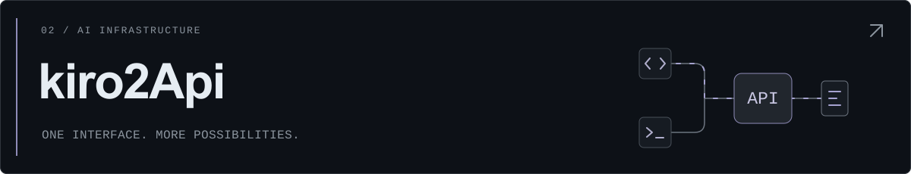
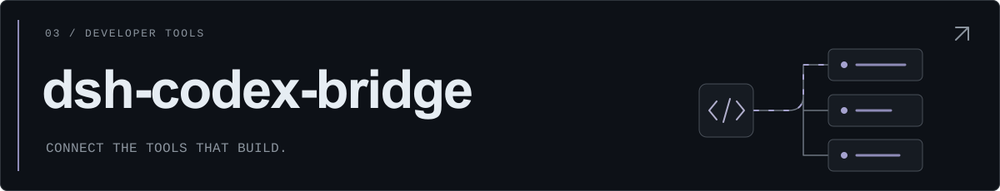

  

  <a href="https://github.com/Lavender3533?tab=repositories">Repositories</a> &nbsp; / &nbsp;
  <a href="https://orcid.org/0009-0006-3768-0670">ORCID</a>

喜欢折腾 AI 工具、API 和自动化，也会做一些让日常使用更顺手的小东西。 
**能自动化的，尽量不手动。**

 

### 一些作品 / Selected work

在 Obsidian 里边看视频边记笔记，支持时间戳跳转、字幕提取和截图。 
<code>TypeScript</code> &nbsp; <code>Obsidian</code> &nbsp; <a href="https://github.com/Lavender3533/obsidian-video-note">查看项目 →</a>

 

把 Kiro 接成 Claude API 兼容服务，支持 AI 编程工具接入和多账号池管理。 
<code>JavaScript</code> &nbsp; <code>Node.js</code> &nbsp; <code>API</code> &nbsp; <a href="https://github.com/Lavender3533/kiro2Api">查看项目 →</a>

 

让 Codex、Claude Code、Cursor 通过 MCP 调用可恢复的 DSH 子代理。 
<code>JavaScript</code> &nbsp; <code>MCP</code> &nbsp; <code>SSE</code> &nbsp; <a href="https://github.com/Lavender3533/dsh-codex-bridge">查看项目 →</a>

 

### 常用 / Toolkit

<code>TypeScript</code> &nbsp; <code>JavaScript</code> &nbsp; <code>Python</code> &nbsp; <code>Java</code> 
<code>Node.js</code> &nbsp; <code>Vue</code> &nbsp; <code>Cloudflare</code> &nbsp; <code>Docker</code> &nbsp; <code>Linux</code>

 

---

Lavender3533 &nbsp; / &nbsp; Built out of curiosity.

